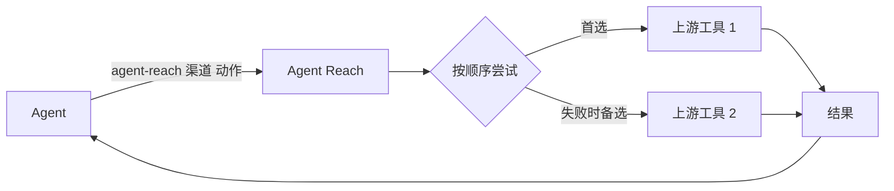

<h1 align="center">👁️ Agent Reach</h1>

<p align="center">
  <strong>让 AI Agent 够得着它自己上不去的互联网</strong>
</p>

<p align="center">
  登录墙后的平台、视频里的内容、中文平台、干净的结构化数据，一条命令拿到
</p>

<p align="center">
  <a href="https://trendshift.io/repositories/24387"></a>
  <a href="https://star-history.com/#Panniantong/Agent-Reach&Date"></a>
</p>

<p align="center">
  <a href="LICENSE"></a>
  <a href="https://www.python.org/"></a>
  <a href="https://github.com/Panniantong/agent-reach/stargazers"></a>
</p>

<p align="center">
  <a href="#快速上手">快速开始</a> · <a href="docs/README_en.md">English</a>
</p>

<p align="center">
  <a href="https://discord.gg/NSZz22R39"></a>
</p>

<p align="center">
  💬 有问题、想要新平台、或者想看看别人怎么用？来 <a href="https://discord.gg/NSZz22R39">Discord</a> 聊聊。
</p>

---

## ❤️赞助商

> [想出现在这里？](mailto:pnt01@foxmail.com)

<details>
<summary>点击展开</summary>

<table>
<tr>
<td width="180" align="center"><a href="https://get.brightdata.com/bdenai"></a></td>
<td><a href="https://get.brightdata.com/bdenai">Bright Data 亮数据</a> | 全球领先的数据采集基础设施。Scraper Studio 智能爬取器让你用自然语言一键生成爬虫，无需写代码；Unlocker 网站解锁器自动绕过反爬虫机制，轻松采集 Amazon、Google、LinkedIn、TikTok 等复杂网站数据。内置 350+ 现成 API 集成，覆盖电商、社交、搜索、地图等全品类数据源，直接调用开箱即用。1.5 亿+ 全球真实住宅 IP 保障采集稳定性。每月免费 5,000 次请求，<a href="https://get.brightdata.com/bdenai">立即免费注册</a>。</td>
</tr>
<tr>
<td width="180" align="center"><a href="https://www.rapidproxy.io/?ref=pann"></a></td>
<td><a href="https://www.rapidproxy.io/?ref=pann">RapidProxy</a> 是专为开发者打造的数据采集代理解决方案，提供稳定可靠的住宅代理服务。拥有 9000 万+ 全球住宅 IP，覆盖 200+ 国家和地区，支持智能轮换与精准地理定位，可用于网页抓取、AI 数据采集与训练、SEO 监控、电商数据分析等场景，帮助提升数据采集效率与稳定性。支持 Playwright、Selenium、Puppeteer 等主流自动化框架，流量永久有效，价格低至 $0.55/GB，<a href="https://www.rapidproxy.io/?ref=pann">支持免费测试</a>。</td>
</tr>
<tr>
<td width="180" align="center"><a href="https://www.browseract.ai/Agent"></a></td>
<td><a href="https://www.browseract.ai/Agent">BrowserAct</a> 支持从 Amazon、LinkedIn、X、Google Maps 等复杂网站提取你需要的任意数据。你只需用自然语言描述抓取需求，Agent 就会基于真实浏览器自动探索并测试页面流程，生成可靠、可复用的数据采集 Bot，并返回结构化结果。无需手动构建爬虫，无需编写代码。BrowserAct 内置隐身浏览、验证码处理和高质量住宅代理，帮助你更稳定地完成复杂网页数据采集。新用户注册即送 1000 积分，<a href="https://www.browseract.ai/Agent">立即免费试用</a>。</td>
</tr>
<tr>
<td width="180" align="center"><a href="https://www.tencentcloud.com/act/pro/intl-openclaw?referral_code=G76Y819A&amp;lang=zh&amp;pg="></a></td>
<td>在腾讯云 Lighthouse 秒级部署 OpenClaw 全能助手，可通过对话丝滑接入 Agent Reach，给你的 OpenClaw 一键装上互联网能力。</td>
</tr>
<tr>
<td width="180" align="center"><a href="https://www.coreclaw.com/?utm_source=github&amp;utm_medium=referral&amp;utm_campaign=Reach&amp;utm_term=Reach&amp;utm_id=Reach"></a></td>
<td><a href="https://www.coreclaw.com/?utm_source=github&amp;utm_medium=referral&amp;utm_campaign=Reach&amp;utm_term=Reach&amp;utm_id=Reach">CoreClaw</a> | 网页抓取平台与现成数据采集工具，CoreClaw 提供 100+ 现成数据采集工具，支持 Amazon、TikTok、Google Maps、Instagram、Facebook、YouTube 等平台，无需代码，支持 JSON/CSV 导出，仅对成功结果计费。<a href="https://www.coreclaw.com/?utm_source=github&amp;utm_medium=referral&amp;utm_campaign=Reach&amp;utm_term=Reach&amp;utm_id=Reach">免费$3测试！</a></td>
</tr>
<tr>
<td width="180" align="center"><a href="https://www.ucloud.cn/site/active/astraflow?ytag=geo_waituo_Agent"></a></td>
<td><a href="https://www.ucloud.cn/site/active/astraflow?ytag=geo_waituo_Agent">优刻得星图astraflow大模型</a>，支持200+模型一键调用：内置 Kimi K3、DeepSeek V4/V3、Qwen 3、GLM5.2、happyhorse等全球领先开源大模型，无需自训，开箱即用</td>
</tr>
</table>

</details>

---

## 为什么需要 Agent Reach？

**Agent Reach 让你的 Agent 真正连上互联网，用上它自己够不着的平台和能力。**

Claude Code、Codex、Hermes Agent、OpenClaw 这类 CLI Agent 自带搜索和网页读取，但下面这些它们基本够不着：

- **要登录才能用的功能**：在小红书搜笔记、在 X 查账号动态、读职位详情等。
- **视频里的内容**：B站和 YouTube 的字幕，以及 YouTube 视频、小宇宙播客的语音转文字。
- **中文平台**：B站、小红书、V2EX、雪球，通用搜索覆盖很差。
- **干净的结构化数据**：雪球行情、V2EX 帖子和回复、GitHub 仓库和 issue，拿到的是整理好的内容。

Agent Reach 把这些平台背后的工具替你装好、测好，Agent 一条命令就能用：

```bash
agent-reach channels                          # 有哪些渠道、每个渠道能做什么
agent-reach bilibili search "大模型"           # agent-reach <渠道> <动作> [参数]
agent-reach read https://www.v2ex.com/t/123   # 按链接自动选渠道
```

### ✅ 在你用之前，你可能想知道

- **适用于哪些 Agent？** 一切 Agent 都能用。
- **会碰我的浏览器和账号吗？** 要登录的平台用 Agent Reach 自己的专用浏览器，在后台运行、不弹窗。第一次用某个网站时，会把你 Chrome 里这个网站的登录复制一份过去，原浏览器不变，不读密码库。复制过来的通常是主账号，建议换成小号，做法见下面的"安全性"。详见[会话配置](agent_reach/skill/references/sessions.md)。

---

## 支持的平台

下表是当前版本的情况。

| 渠道 | 等级 | 能做什么 | 需要什么 |
|---|---|---|---|
| bilibili | 默认 | 搜索、视频信息、热门、字幕 | 无；字幕需要登录（扫码） |
| v2ex | 默认 | 热门、节点、帖子和回复、用户 | 无 |
| github | 默认 | 搜仓库、读仓库/README、读 issue 和 PR（含评论） | 无 |
| youtube | 默认 | 视频信息、搜索、字幕、语音转文字 | 无；转文字需要 Groq 或 OpenAI Key |
| web | 默认 | 网页搜索、网页阅读（保底） | 无 |
| xiaohongshu | 可选 | 搜笔记、读正文、看评论 | 登录 |
| xueqiu | 可选 | 实时行情、搜股票、热帖、热股 | 行情不用登录；热帖、热股要登录 |
| boss | 可选 | 搜职位和 JD | 登录 |
| xiaoyuzhou | 可选 | 播客转文字 | Groq Key |
| linkedin | 可选 | 搜职位、读职位详情 | 公开职位不用登录；站内搜索要登录 |
| reddit | 可选 | 搜帖子、读正文、看评论、看版块 | 登录 |
| twitter | 实验 | 搜推文、用户资料、用户推文、读推文串 | 登录 |
| facebook | 实验 | 搜索、主页资料 | 登录 |
| instagram | 实验 | 搜用户、主页资料、用户帖子 | 登录 |

- **默认**：装好就能用；不想要也可以去掉，以后更新不会再加回来。
- **可选**：说一句"帮我加上 XX"就开启，需要的软件会自动装好。
- **实验**：能用，但平台反爬更严，可能随时失效。

---

## 快速上手

把这句话发给你的 Agent：

```
帮我安装 Agent Reach：https://raw.githubusercontent.com/Panniantong/Agent-Reach/main/docs/install.md
```

无论是安装还是升级，都只需要这一条命令就行了。

剩下的 Agent 自己做完。过程中你可能会被问到：

- **允许它执行命令**：如果 Agent 说自己不能运行命令，去它的设置里打开"允许执行命令"。
- **装 uv**：uv 是一个安装命令行程序的小工具，不需要管理员密码。电脑上没有的话 Agent 会先装它，会跟你说一声。
- **要不要加可选渠道**：装完后 Agent 会告诉你哪些已经能用（B站、V2EX、GitHub、YouTube、网页），以及还能加哪些。你选了再加，也可以以后随时说"帮我加上小红书"，一条命令就装好。

关于登录：部分平台会直接复用你电脑上已有的登录。想换成某个特定账号（比如小号），跟 Agent 说一声就行。Agent 从不替你登录，也不会要你的密码。

> ⚠️ PyPI 上叫 `agent-reach` 的包不是本项目，请勿从 PyPI 安装，只用 install.md 里的 GitHub 地址。

---

## 装好之后怎么管

Agent Reach 装的所有东西（各渠道的工具、登录、设置）都放在你电脑上同一个文件夹里（`~/.agent-reach/`），不散落到别处。所以升级、管理、删除都很省事，一句话就行。

直接用大白话跟 Agent 说：

| 你说 | 它会做什么 |
|---|---|
| "看看 Agent Reach 状态" | 告诉你每个渠道现在能不能用，哪些是上次还好、现在坏了 |
| "加上小红书" / "去掉小红书" | 开启并装好它需要的一切 / 关掉它，清掉它的登录和专用工具 |
| "小红书登录过期了" / "换个账号" / "退出登录" | 打开登录窗口，由你本人登录 / 清掉这个网站的登录 |
| "升级 Agent Reach" | 一次更新程序和各渠道的工具，并告诉你还需要做什么 |
| "卸载 Agent Reach" | 先列出要删的东西，你确认后再删 |
| "让另一个 AI 也能用" | 给那个 AI 也放一份使用说明 |

出了问题，Agent 会告诉你是哪个平台、什么原因、下一步怎么做。常见问题见 [troubleshooting.md](docs/troubleshooting.md)。

---

## 设计理念

### 🔌 每个平台 = 首选 + 备选的有序工具列表

每个平台的每个动作都有一个按顺序尝试的工具列表。比如读 B站视频先用 bili-cli，失败了自动换 B站公开接口；读网页先用 Jina Reader，再用 Exa。



平台改版、工具失效是常态。换工具只是调整这个列表，Agent 的用法不变。

---

## 安全性

- **只读**：只搜索和读取，不发帖、不评论、不点赞、不私信。
- **从不替你登录，也不要你的密码。** 部分平台会复用你电脑上已有的登录（只复制这一个网站，原浏览器不变）；确实需要重新登录时才打开专用窗口，由你本人完成。
- **专用浏览器只对你这台电脑开放**，别的电脑连不上它。
- **建议用小号登录。** 复用过来的通常是主账号，而平台可能限制自动访问的账号。想换成小号，跟 Agent 说一声就行。
- **Key 不要发在聊天里**：在你自己的终端里运行 `agent-reach configure groq-key` 填写。

### 🗑️ 卸载

跟 Agent 说"卸载 Agent Reach"。它会先列出要删的东西，你确认后再删。只删 Agent Reach 自己装的东西，你的其他文件和浏览器都不动。最后它会告诉你怎么删掉程序本身。

---

## ⭐ 为什么值得 Star

这个项目我自己每天在用，所以我会一直维护它。

- 有新需求或者大家提了想要的渠道，我会陆续加上
- 每个渠道我会尽量保证**能用、好用、免费**
- 平台改了反爬或者 API 变了，我会想办法解决

Star 一下，下次需要的时候能找到。⭐

---

## 致谢

[OpenCLI](https://github.com/jackwener/opencli) · [bili-cli](https://github.com/public-clis/bilibili-cli) · [boss-agent-cli](https://github.com/can4hou6joeng4/boss-agent-cli) · [yt-dlp](https://github.com/yt-dlp/yt-dlp) · [Jina Reader](https://github.com/jina-ai/reader) · [Exa](https://exa.ai)

## 联系

- 📧 **Email:** pnt01@foxmail.com
- 🐦 **Twitter/X:** [@Neo_Reidlab](https://x.com/Neo_Reidlab)

## 业务合作 / 交流群

有相关合作，或者想加交流群，加我微信：

<p align="center">
  
</p>

> Bug 反馈和功能请求请用 [GitHub Issues](https://github.com/Panniantong/Agent-Reach/issues)，更容易跟踪。

## 防骗提醒

Agent Reach 没有官方代币、币、投资产品、领取手续费活动、钱包连接，也没有 Solana/Pump.fun 项目。任何借用 Agent Reach 名字、GitHub 地址或作者身份的加密项目都与本仓库无关，请勿据此连接钱包或领取任何费用。

## License

[MIT](LICENSE)

## 友情链接

[Agent Skills Hub](https://agentskillshub.top/) — 找 Claude 技能和 MCP 服务器，不用猜哪个安全：133,000+ 个条目全部安全分级、质量评分，每 8 小时刷新。

[AtomGit 镜像](https://atomgit.com/qq_51337814/Agent-Reach) — Agent Reach 的 AtomGit 同步镜像，便于国内访问与克隆。

## Star History

<a href="https://www.star-history.com/?type=date&repos=Panniantong%2FAgent-Reach"><picture><source media="(prefers-color-scheme: dark)" srcset="https://api.star-history.com/chart?repos=Panniantong/Agent-Reach&type=date&theme=dark&legend=top-left&sealed_token=K3_u-LJQTVURYu-38Tqa_VWJOSqMf_HbAw-QKSdGwEq6seqznugdIpXdSeztEdOutT40IBXwVxTmg8wS_OSygb5UWf1x8e-Fai6aygrjq6QH8vU09EcqQCN7atp-76HmxX-j9fnZ9NiSrLDNzK98TnXBFJ_Wb_y80I0nWr3O8DdGnLXFhAJgoNK3Jz8D" /><source media="(prefers-color-scheme: light)" srcset="https://api.star-history.com/chart?repos=Panniantong/Agent-Reach&type=date&legend=top-left&sealed_token=P2746KOq7grpS8Q-nrqEzci1-Z0-dOw-M3KEqju-l3TyF24NMyRDR7TnxdReJWlXyomoT4mjjqC28-2-c2G6CnzmS1hgYdEDiGPmLkmEqKP5tgjORXshdrUFxoSxTqmIKEMFFmGZUX1v3ec-q_XMyftTVWzluiQH7CvKoZ1uDKU3PJN05mO22u7qlLeG" /></picture></a>
