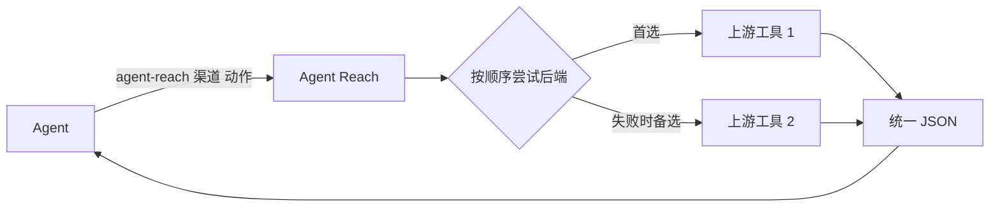

> 一句话配置、MCP 与会话恢复流程见 [one-sentence-harness.md](docs/one-sentence-harness.md)。

<h1 align="center">👁️ Agent Reach</h1>

<p align="center">
  <strong>让 AI Agent 够得着它自己上不去的互联网</strong>
</p>

<p align="center">
  登录墙后的平台、视频里的内容、中文平台、干净的结构化数据，一条命令拿到，统一 JSON 输出
</p>

<p align="center">
  <a href="https://trendshift.io/repositories/24387"></a>
  <a href="https://star-history.com/#Panniantong/Agent-Reach&Date"></a>
</p>

<p align="center">
  <a href="LICENSE"></a>
  <a href="https://www.python.org/"></a>
  <a href="https://github.com/Panniantong/agent-reach/stargazers"></a>
</p>

<p align="center">
  <a href="#快速上手">快速开始</a> · <a href="docs/README_en.md">English</a> · <a href="#支持的平台">支持平台</a> · <a href="#设计理念">设计理念</a>
</p>

---

## ❤️赞助商

> [想出现在这里？](mailto:pnt01@foxmail.com)

<details open>
<summary>点击折叠</summary>

<table>
<tr>
<td width="180" align="center"><a href="https://www.browseract.ai/Agent"></a></td>
<td><a href="https://www.browseract.ai/Agent">BrowserAct</a> 支持从 Amazon、LinkedIn、X、Google Maps 等复杂网站提取你需要的任意数据。你只需用自然语言描述抓取需求，Agent 就会基于真实浏览器自动探索并测试页面流程，生成可靠、可复用的数据采集 Bot，并返回结构化结果。无需手动构建爬虫，无需编写代码。BrowserAct 内置隐身浏览、验证码处理和高质量住宅代理，帮助你更稳定地完成复杂网页数据采集。新用户注册即送 1000 积分，<a href="https://www.browseract.ai/Agent">立即免费试用</a>。</td>
</tr>
<tr>
<td width="180" align="center"><a href="https://www.tencentcloud.com/act/pro/intl-openclaw?referral_code=G76Y819A&amp;lang=zh&amp;pg="></a></td>
<td>在腾讯云 Lighthouse 秒级部署 OpenClaw 全能助手，可通过对话丝滑接入 Agent Reach，给你的 OpenClaw 一键装上互联网能力。</td>
</tr>
<tr>
<td width="180" align="center"><a href="https://www.coreclaw.com/?utm_source=github&amp;utm_medium=referral&amp;utm_campaign=Reach&amp;utm_term=Reach&amp;utm_id=Reach"></a></td>
<td><a href="https://www.coreclaw.com/?utm_source=github&amp;utm_medium=referral&amp;utm_campaign=Reach&amp;utm_term=Reach&amp;utm_id=Reach">CoreClaw</a> | 网页抓取平台与现成数据采集工具，CoreClaw 提供 100+ 现成数据采集工具，支持 Amazon、TikTok、Google Maps、Instagram、Facebook、YouTube 等平台，无需代码，支持 JSON/CSV 导出，仅对成功结果计费。<a href="https://www.coreclaw.com/?utm_source=github&amp;utm_medium=referral&amp;utm_campaign=Reach&amp;utm_term=Reach&amp;utm_id=Reach">免费$3测试！</a></td>
</tr>
<tr>
<td width="180" align="center"><a href="https://www.ucloud.cn/site/active/astraflow?ytag=geo_waituo_Agent"></a></td>
<td><a href="https://www.ucloud.cn/site/active/astraflow?ytag=geo_waituo_Agent">优刻得星图astraflow大模型</a>，支持200+模型一键调用：内置 Kimi K3、DeepSeek V4/V3、Qwen 3、GLM5.2、happyhorse等全球领先开源大模型，无需自训，开箱即用</td>
</tr>
</table>

</details>

---

## 为什么需要 Agent Reach？

Claude Code、Codex、Hermes Agent、OpenClaw 这类 CLI Agent 自带搜索和网页读取，但下面这些它们基本够不着：

- **要登录才能看的平台**：小红书、Twitter/X、Reddit、LinkedIn、Boss直聘……网页抓不到，或者只能看到登录页。
- **视频里的内容**：YouTube 和 B站的字幕，以及 YouTube 视频的语音转文字。
- **中文平台**：B站、小红书、V2EX、雪球，通用搜索覆盖很差。
- **干净的结构化数据**：雪球行情、V2EX 帖子和回复、GitHub 仓库和 issue，直接给字段，不用从 HTML 里猜。

Agent Reach 安装这些平台背后的工具，提供已测依赖与验收流程，然后给 Agent 一个统一入口：

```bash
agent-reach channels                          # 有哪些渠道、每个渠道能做什么
agent-reach bilibili search "大模型"           # agent-reach <渠道> <动作> [参数]
agent-reach read https://www.v2ex.com/t/123   # 按链接自动选渠道
```

每条命令都输出同一种 JSON，Agent 不用学每个工具的用法，也不用解析各家五花八门的输出。

> `web` 渠道（网页搜索和阅读）只是保底：Agent 自带的搜索或网页读取不可用、或者读失败时再用它。

### ✅ 在你用之前，你可能想知道

- **适用于哪些 Agent？** 任何能执行命令行的 Agent。`agent-reach setup` 会放一份使用说明（skill，就是告诉 AI 怎么用 Agent Reach 的说明文件），Codex、OpenCode 等直接能读到；Claude Code、OpenClaw、Cursor 等装了的话，会在它们的 skill 目录里放一个指向这份说明的链接（相当于快捷方式）。
- **要花钱吗？** 程序和后端工具都是开源免费的。YouTube 视频转文字需要 Groq 或 OpenAI Key；`ask` 的自动意图解析和总结需要你配置一个兼容的模型 API Key。直接使用渠道命令或 MCP 工具无需模型 Key。
- **会碰我的浏览器和账号吗？** 优先复用你选定的已有浏览器或工具会话，不默认复制 Cookie，也不替你登录。只有明确选择才开专用浏览器。详见[会话配置](agent_reach/skill/references/sessions.md)。
- **支持哪些系统？** 优先保证 macOS，Linux 可用，Windows 尽力支持。
- **要我自己装别的软件吗？** `agent-reach add` 安装渠道工具；OpenCLI 扩展需要连接到你选择的日常 Chrome。先复用已有登录，确实失效时才重新登录。
- **怎么知道有新版本？** Agent Reach 每天最多在后台查一次，有新版本时 Agent 会用大白话告诉你改了什么、问你要不要更新，你同意了才更新。

---

## 支持的平台

`agent-reach channels` 是实时的准确来源，下表是当前版本的情况。

| 渠道 | 等级 | 能做什么 | 需要什么 |
|---|---|---|---|
| github | 默认 | 搜仓库、读仓库/README、读 issue 和 PR（含评论） | 无（装了 `gh` 或配置 token 后额度更高） |
| youtube | 默认 | 视频信息、搜索、字幕、语音转文字 | 无；转文字需要 Groq 或 OpenAI Key |
| v2ex | 默认 | 热门、节点、帖子和回复、用户 | 无 |
| web | 默认 | 网页搜索、网页阅读（保底） | 无 |
| bilibili | 默认 | 搜索、视频信息、热门、字幕 | 无；字幕需要登录（扫码） |
| xiaohongshu | 可选 | 搜笔记、读笔记 | 浏览器 + 登录 |
| reddit | 可选 | 搜索、读帖子和评论、看版块 | 浏览器 + 登录 |
| linkedin | 可选 | 搜职位、读职位详情 | 登录 |
| boss | 可选 | 搜职位和 JD | 浏览器 + 登录 |
| xueqiu | 可选 | 实时行情、搜股票、热帖、热股 | 行情免登录；热帖热股需要浏览器登录 |
| twitter | 实验 | 搜推文、用户资料、用户推文、读推文串 | 浏览器 + 登录 |
| facebook | 实验 | 搜索、主页资料 | 浏览器 + 登录 |
| instagram | 实验 | 搜用户、主页资料、用户帖子 | 浏览器 + 登录 |

- **默认**：装好就能用；不想要也可以去掉（`agent-reach remove <渠道>`），以后更新不会再加回来。
- **可选**：用 `agent-reach add <渠道>` 按需开启，它需要的一切 Agent Reach 都会装到自己的目录里。
- **实验**：能用，但平台反爬更严，可能随时失效。
- **浏览器**：优先复用现有会话。`browser profiles` 发现 OpenCLI 连接，`browser use ID` 一次选择供多个渠道复用。Cloak 有独立会话；只在你显式指定 `--reuse-profile ID` 后导入该站点登录态。BOSS 的原生 CLI 后备路径才需要 CDP。

---

## 快速上手

把这句话发给你的 Agent：

```
帮我安装 Agent Reach，按 docs/install.md 优先复用已有登录态。
```

剩下的 Agent 会照着 [install.md](docs/install.md) 自己做完。过程中你可能会被问到：

- **允许它执行命令**：如果 Agent 说自己不能运行命令，去它的设置里打开"允许执行命令"。
- **装 uv**：uv 是一个安装命令行程序的小工具，不需要管理员密码。电脑上没有的话 Agent 会先装它，会跟你说一声。
- **要不要加可选渠道**：装完后 Agent 会告诉你哪些已经能用（网页、YouTube、GitHub、V2EX、B站），以及还能加哪些。你选了再加，也可以以后随时说"帮我加上小红书"，一条命令就装好。

需要你本人做的只有登录，Agent 从不替你登录，也不会要你的密码：

- 小红书、Reddit、Twitter 等：选择已登录的日常 Chrome；验收提示 NEED_LOGIN 时才在该窗口登录。
- B站：字幕要扫码登录；不登录也能搜索和看视频信息。

> ⚠️ PyPI 上叫 `agent-reach` 的包不是本项目，请勿从 PyPI 安装，只用 install.md 里的 GitHub 地址。

想自己动手也一样，照着 [install.md](docs/install.md) 敲命令就行。

配置好模型后，可直接运行 `agent-reach ask "帮我去小红书找深圳数据平台笔记并总结"`。首次用某渠道时，Reach 会安装其依赖并复用已授权的登录来源；需要你登录时返回 `operation_id`，完成后运行 `agent-reach resume OPERATION_ID`。安装了 Cursor 时，`agent-reach setup` 会注册本机 MCP 服务；也可运行 `agent-reach mcp install cursor`。MCP 与 CLI 共用同一套准备、执行和验收流程。



---

## 装好之后怎么管

直接用大白话跟 Agent 说就行，它会替你运行对应的命令：

| 你说 | Agent 运行 | 作用 |
|---|---|---|
| "看看 Agent Reach 状态" | `agent-reach doctor --text` | 每个渠道的状态：未开启 / 待配置 / 待登录 / 未验证 / 可用 / 故障，并标出"上次还好、现在坏了"的渠道 |
| "加上小红书" / "去掉小红书" | `agent-reach add` / `remove <渠道>` | 开启渠道并装好它需要的一切，你只需登录或提供 Key / 关闭渠道并清掉它的登录和专用工具（默认渠道也能去掉） |
| "B站登录过期了" / "退出登录" | `agent-reach login` / `logout <渠道>` | 登录（你本人操作）/ 清除登录 |
| "升级 Agent Reach" | `agent-reach update` | 一次更新程序、各渠道的工具（升到最新）和 skill，并告诉你还需要做什么，见 [update.md](docs/update.md) |
| "卸载 Agent Reach" | `agent-reach uninstall` | 见下面"安全性"里的卸载说明 |
| "让另一个 AI 也能用" | `agent-reach skill link <它的 skill 目录>` | 给不在自动名单里的 AI 也放一个说明链接 |

其他：`agent-reach check [渠道] --text` 真实跑一遍测试；`agent-reach configure <项>` 保存 `groq-key`、`openai-key`、`proxy`、`github-token`。

出错时，JSON 里的 `error.code` 会告诉 Agent 下一步该做什么。每种错误和状态的处理办法见 [troubleshooting.md](docs/troubleshooting.md)。

---

## 设计理念

### 🔌 每个平台 = 首选 + 备选的有序后端列表

每个渠道的每个动作都有一个有序的后端列表。比如 `bilibili read` 先用 bili-cli，失败了自动换 B站公开接口；`web read` 先用 Jina Reader，再用 Exa。返回的 JSON 里 `backend` 字段会写明这次实际用的是谁。

平台改版、工具失效是常态。换后端只是调整这个列表，Agent 的调用方式不变。

### 📌 保持最新，私有安装

Agent Reach 装的工具位于 `~/.agent-reach/tools/`，可复用现有 OpenCLI。部分工具固定为已测版本，Boss 固定到已验证提交；`doctor` 显示实际版本。

### 🩺 能用要靠实测

`doctor` 只做离线检查；`check` 会真的去平台上请求一次。一个渠道只有通过实测才会标为"可用"。

### 统一输出

所有 Agent 命令都输出一个 JSON：

```json
{"schema_version": 1, "ok": true, "channel": "v2ex", "action": "hot", "backend": "v2ex-api",
 "items": [{"title": "...", "url": "...", "text": "..."}], "meta": {}, "error": null}
```

失败时 `ok` 为 `false`，`error` 里有 `code`（`NEED_SETUP` / `NEED_LOGIN` / `UPSTREAM_BROKEN` / `TIMEOUT` / `RATE_LIMITED` / `NOT_FOUND` / `BAD_INPUT`）、`message` 和给 Agent 的 `hint`。

---

## 安全性

- **所有东西都在 `~/.agent-reach/` 下**：`config.yaml`（Key 和代理）、`state.json`、`tools/`（私有工具）、`sessions/`（命令行工具的登录状态）、`browser/`（专用浏览器的资料目录）、`mcporter.json`。唯一例外是使用说明：一份放在 `~/.agents/skills/agent-reach/`，其他 AI 的 skill 目录里只放指向它的链接。
- **从不替你登录，不默认搬运 Cookie。** 先复用选定会话；需要认证时才进入明确选择的工具登录流程。Boss 原生 CDP 同步按工具机制保存到私有目录。
- **CDP 调试端口只监听本机**。Boss 标准 CDP 窗口需用户使用后自行关闭；旧扩展专用模式的空闲退出机制不适用于它。
- **建议用小号登录。** 平台可能限制自动化访问的账号，别拿主账号冒险。
- **API Key 不要发在聊天里**：在你自己的终端运行 `agent-reach configure groq-key`，会隐藏输入。

### 🗑️ 卸载

```bash
agent-reach uninstall --dry-run   # 先看会删哪些东西
agent-reach uninstall             # 删除 Agent Reach 装的工具、登录、配置和 skill
```

卸载前先关掉 Agent Reach 专用浏览器。命令最后会告诉你怎么卸载程序本身（比如 `uv tool uninstall agent-reach`）。

---

## ⭐ 为什么值得 Star

这个项目我自己每天在用，所以我会一直维护它。

- 有新需求或者大家提了想要的渠道，我会陆续加上
- 每个渠道我会尽量保证**能用、好用、免费**
- 平台改了反爬或者 API 变了，我会想办法解决

为 Web 4.0 基建贡献一份自己的力量。

Star 一下，下次需要的时候能找到。⭐

---

## 致谢

[OpenCLI](https://github.com/jackwener/opencli) · [bili-cli](https://github.com/public-clis/bilibili-cli) · [boss-agent-cli](https://github.com/can4hou6joeng4/boss-agent-cli) · [yt-dlp](https://github.com/yt-dlp/yt-dlp) · [Jina Reader](https://github.com/jina-ai/reader) · [Exa](https://exa.ai) · [mcporter](https://github.com/nicobailon/mcporter) · [mcp-server-linkedin](https://github.com/stickerdaniel/linkedin-mcp-server)

## 联系

- 📧 **Email:** pnt01@foxmail.com
- 🐦 **Twitter/X:** [@Neo_Reidlab](https://x.com/Neo_Reidlab)

## 业务合作 / Agent 落地

我正在承接 Agent 相关的定制与落地合作。

如果你在企业生产、运营、市场、投研、数据处理、内容处理或其他业务流程里，有希望用 Agent 自动化的环节，欢迎加我微信交流。

不需要你已经想清楚方案。只要你有真实流程、真实问题或真实需求，我可以一起判断 Agent 能不能解决、怎么做。

加好友请备注：`业务 + 你想让 Agent 帮你做什么`

Builder 也欢迎备注：`Builder + 你在做什么`

只是想进交流群，备注：`加群`

<p align="center">
  
</p>

> Bug 反馈和功能请求请用 [GitHub Issues](https://github.com/Panniantong/Agent-Reach/issues)，更容易跟踪。

## License

[MIT](LICENSE)

## 友情链接

[Agent Skills Hub](https://agentskillshub.top/) — 找 Claude 技能和 MCP 服务器，不用猜哪个安全：133,000+ 个条目全部安全分级、质量评分，每 8 小时刷新。

[AtomGit 镜像](https://atomgit.com/qq_51337814/Agent-Reach) — Agent Reach 的 AtomGit 同步镜像，便于国内访问与克隆。

## Star History

<a href="https://www.star-history.com/?type=date&repos=Panniantong%2FAgent-Reach"><picture><source media="(prefers-color-scheme: dark)" srcset="https://api.star-history.com/chart?repos=Panniantong/Agent-Reach&type=date&theme=dark&legend=top-left&sealed_token=K3_u-LJQTVURYu-38Tqa_VWJOSqMf_HbAw-QKSdGwEq6seqznugdIpXdSeztEdOutT40IBXwVxTmg8wS_OSygb5UWf1x8e-Fai6aygrjq6QH8vU09EcqQCN7atp-76HmxX-j9fnZ9NiSrLDNzK98TnXBFJ_Wb_y80I0nWr3O8DdGnLXFhAJgoNK3Jz8D" /><source media="(prefers-color-scheme: light)" srcset="https://api.star-history.com/chart?repos=Panniantong/Agent-Reach&type=date&legend=top-left&sealed_token=P2746KOq7grpS8Q-nrqEzci1-Z0-dOw-M3KEqju-l3TyF24NMyRDR7TnxdReJWlXyomoT4mjjqC28-2-c2G6CnzmS1hgYdEDiGPmLkmEqKP5tgjORXshdrUFxoSxTqmIKEMFFmGZUX1v3ec-q_XMyftTVWzluiQH7CvKoZ1uDKU3PJN05mO22u7qlLeG" /></picture></a>


### CloakBrowser 优先

小红书、BOSS 搜索现在优先 CloakBrowser，其次 OpenCLI；BOSS 原生 CLI 保留为第三后端。两站均支持 `read`（BOSS 的 read 目前仅 CloakBrowser）。使用前显式导入已有登录态，不会在查询中自动复制 Cookie。安装、登录、回退边界与真实验收见 [CloakBrowser 接入说明](docs/cloakbrowser.md)。
