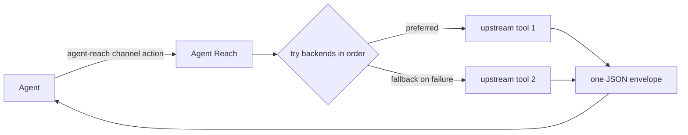

> Session reuse and the resumable MCP flow require the matching runtime and Skill. See [one-sentence-harness.md](one-sentence-harness.md).

<h1 align="center">👁️ Agent Reach</h1>

<p align="center">
  <strong>Let your AI agent reach the parts of the internet it can't reach on its own</strong>
</p>

<p align="center">
  Login-walled platforms, what's inside videos, Chinese platforms, clean structured data. One command, one JSON shape.
</p>

<p align="center">
  <a href="https://trendshift.io/repositories/24387"></a>
  <a href="https://star-history.com/#Panniantong/Agent-Reach&Date"></a>
</p>

<p align="center">
  <a href="../LICENSE"></a>
  <a href="https://www.python.org/"></a>
  <a href="https://github.com/Panniantong/agent-reach/stargazers"></a>
</p>

<p align="center">
  <a href="#quick-start">Quick Start</a> · <a href="../README.md">中文</a> · <a href="#supported-platforms">Platforms</a> · <a href="#design-philosophy">Philosophy</a>
</p>

> **No token or crypto affiliation:** Agent Reach has no official token, coin, investment product, fee-claim program, wallet connection, or Solana/Pump.fun project. Any crypto project using the Agent Reach name, GitHub URL, or author identity is not affiliated with this repository. Do not connect a wallet or claim fees based on messages, posts, or links that say otherwise.

---

## ❤️ Sponsors

> [Want to appear here?](mailto:pnt01@foxmail.com)

<details open>
<summary>Click to collapse</summary>

<table>
<tr>
<td width="180" align="center"><a href="https://www.browseract.ai/Agent"></a></td>
<td><a href="https://www.browseract.ai/Agent">BrowserAct</a> extracts any data you need from complex websites such as Amazon, LinkedIn, X, and Google Maps. Simply describe your extraction request in natural language, and its Agent will explore and test page flows in a real browser, generate a reliable reusable data-collection Bot, and return structured results. There is no need to build a scraper or write code. Built-in stealth browsing, CAPTCHA handling, and high-quality residential proxies help make complex web data extraction more reliable. New users receive 1,000 credits upon registration. <a href="https://www.browseract.ai/Agent">Try it free now</a>.</td>
</tr>
<tr>
<td width="180" align="center"><a href="https://www.tencentcloud.com/act/pro/intl-openclaw?referral_code=G76Y819A&amp;lang=en&amp;pg="></a></td>
<td>Deploy OpenClaw on Tencent Cloud Lighthouse in seconds, connect Agent Reach through chat, and add internet access to your OpenClaw setup.</td>
</tr>
<tr>
<td width="180" align="center"><a href="https://www.coreclaw.com/?utm_source=github&amp;utm_medium=referral&amp;utm_campaign=Reach&amp;utm_term=Reach&amp;utm_id=Reach"></a></td>
<td><a href="https://www.coreclaw.com/?utm_source=github&amp;utm_medium=referral&amp;utm_campaign=Reach&amp;utm_term=Reach&amp;utm_id=Reach">CoreClaw</a> | Web scraping platform and ready-made data collection tools. CoreClaw provides 100+ ready-made data collection tools for Amazon, TikTok, Google Maps, Instagram, Facebook, YouTube, and more. No code required, with JSON/CSV exports and billing only for successful results. <a href="https://www.coreclaw.com/?utm_source=github&amp;utm_medium=referral&amp;utm_campaign=Reach&amp;utm_term=Reach&amp;utm_id=Reach">Free $3 trial!</a></td>
</tr>
<tr>
<td width="180" align="center"><a href="https://www.ucloud.cn/site/active/astraflow?ytag=geo_waituo_Agent"></a></td>
<td><a href="https://www.ucloud.cn/site/active/astraflow?ytag=geo_waituo_Agent">AstraFlow ModelVerse</a> provides one-click access to 200+ models, including leading open-source models such as Kimi K3, DeepSeek V4/V3, Qwen 3, GLM5.2, and happyhorse. No training required—ready to use out of the box.</td>
</tr>
</table>

</details>

---

## Why Agent Reach?

CLI agents such as Claude Code, Codex, Hermes Agent and OpenClaw come with web search and page fetching, but they mostly can't reach:

- **Login-walled platforms**: XiaoHongShu, Twitter/X, Reddit, LinkedIn, Boss Zhipin... a plain fetch gets nothing or a login page.
- **What's inside video**: YouTube and Bilibili subtitles, plus speech-to-text for YouTube videos.
- **Chinese platforms**: Bilibili, XiaoHongShu, V2EX and Xueqiu, which general search covers poorly.
- **Clean structured data**: Xueqiu quotes, V2EX topics and replies, GitHub repos and issues, as fields instead of HTML to guess from.

Agent Reach installs the open-source tools behind these platforms, keeps them up to date, health-checks them, and gives the agent one entry point:

```bash
agent-reach channels                          # which channels exist and what each can do
agent-reach bilibili search "LLM"             # agent-reach <channel> <action> [args]
agent-reach read https://www.v2ex.com/t/123   # picks the channel from the link
```

Every command prints the same JSON shape, so the agent doesn't have to learn each tool or parse each tool's output.

> The `web` channel (web search and page reading) is only a fallback, for when the agent's own search or fetch is missing or fails.

### ✅ Before you start, you might want to know

- **Which agents?** Any agent that can run shell commands. `agent-reach setup` places one copy of the usage instructions (a skill) that Codex, OpenCode and others read directly, and links it into the skill folders of Claude Code, OpenClaw, Cursor and others when they are installed.
- **Does it cost money?** The program and its backends are open source and free. The only keys you may need are for speech-to-text: Groq (has a free tier) or OpenAI Whisper.
- **Sessions**: use the explicitly selected browser/tool session. No automatic cookie migration or new browser; the user authenticates only when needed.
- **Which OS?** macOS first, Linux works, Windows best effort.
- **Dependencies**: add installs tools. Connect the OpenCLI extension in your existing Chrome; login is needed only when the existing session fails verification.
- **How do I hear about new versions?** Agent Reach checks at most once a day in the background. When there is a new version, your agent tells you in plain words what changed and asks whether to update; it updates only if you say yes.

---

## Supported Platforms

`agent-reach channels` is the live source of truth; this table reflects the current release.

| Channel | Level | What it does | Needs |
|---|---|---|---|
| github | default | search repos, read a repo/README, read issues and PRs with comments | nothing (higher limits with `gh` or a token) |
| youtube | default | video info, search, subtitles, speech-to-text | nothing; speech-to-text needs a Groq or OpenAI key |
| v2ex | default | hot topics, nodes, topics with replies, users | nothing |
| web | default | web search, page reading (fallback) | nothing |
| bilibili | default | search, video info, trending, subtitles | nothing; subtitles need a login (QR scan) |
| xiaohongshu | optional | search notes, read a note | browser + login |
| reddit | optional | search, read posts with comments, browse a subreddit | browser + login |
| linkedin | optional | job search | login |
| boss | optional | job and JD search | browser + login |
| xueqiu | optional | real-time quotes, stock search, hot posts, hot stocks | quotes need nothing; hot posts/stocks need a browser login |
| twitter | experimental | search tweets, profiles, user tweets, threads | browser + login |
| facebook | experimental | search, profiles | browser + login |
| instagram | experimental | user search, profiles, user posts | browser + login |

- **default**: works right after install; you can remove one (`agent-reach remove <channel>`) and updates won't add it back.
- **optional**: turn on with `agent-reach add <channel>`; Agent Reach installs everything it needs into its own folder.
- **experimental**: works, but the platform fights automation harder and it can break at any time.
- **browser**: reuse a selected existing session. Use `browser profiles` and `browser use ID` for OpenCLI. Boss requires an existing CDP page; only explicit `login boss --new-browser` opens its persistent profile.

---

## Quick Start

Send this to your agent:

```
Install this modified Agent Reach checkout/wheel using its docs/install.md.
```

The agent does the rest by following [install.md](install.md). Along the way you may be asked to:

- **Let it run commands**: if the agent says it can't run commands, turn on command execution in its settings.
- **Allow installing uv**: uv is a small tool that installs command-line programs; no admin password needed. The agent installs it first if it's missing and tells you.
- **Pick optional channels**: afterwards the agent tells you what works now (web, YouTube, GitHub, V2EX, Bilibili) and what else you can add. Pick now, or later just say "add Xiaohongshu"; one command sets it up.

The only thing you do yourself is log in; the agent never logs in for you and never asks for your password:

- Xiaohongshu, Reddit, Twitter: select an existing Chrome session and verify it before asking for login.
- Bilibili: subtitles need a QR-scan login; search and video info work without it.

> ⚠️ The PyPI package named `agent-reach` is NOT this project. Don't install it from PyPI; use the GitHub URL in install.md.

Prefer doing it by hand? Run the commands in [install.md](install.md) yourself.



---

## After Install: Managing It

Just tell your agent in plain words; it runs the command for you:

| You say | Agent runs | What it does |
|---|---|---|
| "How is Agent Reach doing?" | `agent-reach doctor --text` | status of every channel: not_added / needs_setup / needs_login / unverified / ready / broken, and which ones broke since the last check |
| "Add Xiaohongshu" / "Remove Xiaohongshu" | `agent-reach add` / `remove <channel>` | turn a channel on and install everything it needs; you only log in or provide a key / turn it off and clear its login and private tools (default channels too) |
| "My Bilibili login expired" / "Log out" | `agent-reach login` / `logout <channel>` | log in (you do it) / forget the login |
| "Upgrade Agent Reach" | `agent-reach update` | update the program, every channel's tools (to their latest versions) and the skill in one go, and tell you anything left to do, see [update.md](update.md) |
| "Uninstall Agent Reach" | `agent-reach uninstall` | see Uninstall under Security below |
| "Let my other AI use it too" | `agent-reach skill link <its skills folder>` | link the instructions for an AI not covered automatically |

Also: `agent-reach check [channel] --text` runs live tests; `agent-reach configure <key>` saves `groq-key`, `openai-key`, `proxy`, `github-token`.

When something fails, `error.code` in the JSON tells the agent what to do next. Every error code and status is explained in [troubleshooting.md](troubleshooting.md).

---

## Design Philosophy

### 🔌 Every platform = an ordered backend list (primary + fallbacks)

Each action of each channel has an ordered list of backends. `bilibili read` tries bili-cli first and falls back to Bilibili's public API; `web read` tries Jina Reader, then Exa. The `backend` field in the JSON says which one actually answered.

Platforms change and tools break all the time. Switching backends only reorders that list; the way the agent calls Agent Reach stays the same.

### 📌 Kept current, private installs

Tools are private under ~/.agent-reach/tools/. Selected dependencies use tested versions; Boss is pinned to a verified Git commit. Do not overwrite this local fork with an upstream update.

### 🩺 Working means live-tested

`doctor` only checks offline; `check` makes a real request to the platform. A channel is marked `ready` only after it passes a live check.

### One output shape

Every agent command prints one JSON object:

```json
{"schema_version": 1, "ok": true, "channel": "v2ex", "action": "hot", "backend": "v2ex-api",
 "items": [{"title": "...", "url": "...", "text": "..."}], "meta": {}, "error": null}
```

On failure `ok` is `false` and `error` holds a `code` (`NEED_SETUP` / `NEED_LOGIN` / `UPSTREAM_BROKEN` / `TIMEOUT` / `RATE_LIMITED` / `NOT_FOUND` / `BAD_INPUT`), a `message`, and a `hint` for the agent.

---

## Security

- **Everything lives under `~/.agent-reach/`**: `config.yaml` (keys and proxy), `state.json`, `tools/` (private tool installs), `sessions/` (logins of CLI tools), `browser/` (the dedicated browser profile), `mcporter.json`. The one exception is the skill: one copy in `~/.agents/skills/agent-reach/`, with only links to it in other AIs' skill folders.
- **Agent Reach never logs in for you and never reads your own browser's cookies.** For login channels you log in yourself, in the Agent Reach browser or in the tool's own login flow (e.g. Bilibili QR scan).
- **CDP** listens on loopback only. Close the standard Boss CDP window manually when finished.
- **Use a secondary account for login channels.** Platforms may restrict accounts used for automated access.
- **Don't paste API keys into chat**: run `agent-reach configure groq-key` in your own terminal; input is hidden.

### 🗑️ Uninstall

```bash
agent-reach uninstall --dry-run   # see what would be removed
agent-reach uninstall             # remove the tools, logins, config and skill Agent Reach installed
```

Close the Agent Reach browser first. The output ends with the command that removes the program itself (e.g. `uv tool uninstall agent-reach`).

---

## Credits

[OpenCLI](https://github.com/jackwener/opencli) · [bili-cli](https://github.com/public-clis/bilibili-cli) · [boss-agent-cli](https://github.com/can4hou6joeng4/boss-agent-cli) · [yt-dlp](https://github.com/yt-dlp/yt-dlp) · [Jina Reader](https://github.com/jina-ai/reader) · [Exa](https://exa.ai) · [mcporter](https://github.com/nicobailon/mcporter) · [mcp-server-linkedin](https://github.com/stickerdaniel/linkedin-mcp-server)

## Contact

- 📧 **Email:** pnt01@foxmail.com
- 🐦 **Twitter/X:** [@Neo_Reidlab](https://x.com/Neo_Reidlab)

For collaboration or questions, add me on WeChat — I'll invite you to the community group:

<p align="center">
  
</p>

> For bug reports and feature requests, please use [GitHub Issues](https://github.com/Panniantong/Agent-Reach/issues) — easier to track.

## License

[MIT](../LICENSE)

## Friends

[Agent Skills Hub](https://agentskillshub.top/) — Find Claude skills & MCP servers without guessing what's safe. Every one of 133,000+ entries is security-graded, quality-scored, and refreshed every 8 hours.

[AtomGit mirror](https://atomgit.com/qq_51337814/Agent-Reach) — Synchronized AtomGit mirror for Agent Reach.

## Star History

<a href="https://www.star-history.com/?type=date&repos=Panniantong%2FAgent-Reach"><picture><source media="(prefers-color-scheme: dark)" srcset="https://api.star-history.com/chart?repos=Panniantong/Agent-Reach&type=date&theme=dark&legend=top-left&sealed_token=K3_u-LJQTVURYu-38Tqa_VWJOSqMf_HbAw-QKSdGwEq6seqznugdIpXdSeztEdOutT40IBXwVxTmg8wS_OSygb5UWf1x8e-Fai6aygrjq6QH8vU09EcqQCN7atp-76HmxX-j9fnZ9NiSrLDNzK98TnXBFJ_Wb_y80I0nWr3O8DdGnLXFhAJgoNK3Jz8D" /><source media="(prefers-color-scheme: light)" srcset="https://api.star-history.com/chart?repos=Panniantong/Agent-Reach&type=date&legend=top-left&sealed_token=P2746KOq7grpS8Q-nrqEzci1-Z0-dOw-M3KEqju-l3TyF24NMyRDR7TnxdReJWlXyomoT4mjjqC28-2-c2G6CnzmS1hgYdEDiGPmLkmEqKP5tgjORXshdrUFxoSxTqmIKEMFFmGZUX1v3ec-q_XMyftTVWzluiQH7CvKoZ1uDKU3PJN05mO22u7qlLeG" /></picture></a>


### Local enhancement: CloakBrowser first

Xiaohongshu and BOSS search prefer CloakBrowser, then OpenCLI. Native Boss remains the third search backend. Both support read; BOSS read currently uses only CloakBrowser. Import existing site cookies explicitly before use; queries never migrate credentials automatically. See [CloakBrowser integration](cloakbrowser.md).
