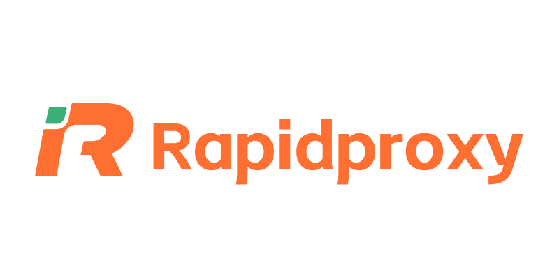
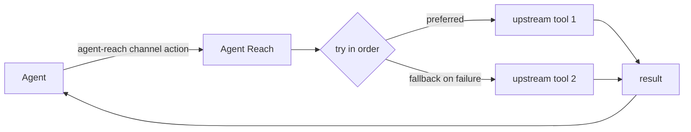

<h1 align="center">👁️ Agent Reach</h1>

<p align="center">
  <strong>Let your AI agent reach the parts of the internet it can't reach on its own</strong>
</p>

<p align="center">
  Login-walled platforms, what's inside videos, Chinese platforms, clean structured data. One command.
</p>

<p align="center">
  <a href="https://trendshift.io/repositories/24387"></a>
  <a href="https://star-history.com/#Panniantong/Agent-Reach&Date"></a>
</p>

<p align="center">
  <a href="../LICENSE"></a>
  <a href="https://www.python.org/"></a>
  <a href="https://github.com/Panniantong/agent-reach/stargazers"></a>
</p>

<p align="center">
  <a href="#quick-start">Quick Start</a> · <a href="../README.md">中文</a>
</p>

<p align="center">
  <a href="https://discord.gg/NSZz22R39"></a>
</p>

<p align="center">
  💬 Questions, a platform you want added, or curious how others use it? Come chat on <a href="https://discord.gg/NSZz22R39">Discord</a>.
</p>

---

## ❤️ Sponsors

> [Want to appear here?](mailto:pnt01@foxmail.com)

<details>
<summary>Click to expand</summary>

<table>
<tr>
<td width="180" align="center"><a href="https://get.brightdata.com/bdenai"></a></td>
<td><a href="https://get.brightdata.com/bdenai">Bright Data</a> | The world's leading web data infrastructure. Scraper Studio builds a scraper from a plain-language description, no code needed; Web Unlocker gets past anti-bot defenses so you can collect data from hard sites like Amazon, Google, LinkedIn and TikTok. 350+ ready-made API integrations cover e-commerce, social, search, maps and more, ready to call out of the box. 150M+ real residential IPs worldwide keep collection stable. 5,000 free requests every month. <a href="https://get.brightdata.com/bdenai">Sign up free</a>.</td>
</tr>
<tr>
<td width="180" align="center"><a href="https://www.rapidproxy.io/?ref=pann"></a></td>
<td><a href="https://www.rapidproxy.io/?ref=pann">RapidProxy</a> is a data-collection proxy service built for developers, with stable, reliable residential proxies. 90M+ residential IPs worldwide cover 200+ countries and regions, with smart rotation and precise geo-targeting, for web scraping, AI data collection and training, SEO monitoring, e-commerce analytics and more. Works with Playwright, Selenium, Puppeteer and other popular automation frameworks. Traffic never expires, prices start at $0.55/GB, and <a href="https://www.rapidproxy.io/?ref=pann">free trials are available</a>.</td>
</tr>
<tr>
<td width="180" align="center"><a href="https://www.browseract.ai/Agent"></a></td>
<td><a href="https://www.browseract.ai/Agent">BrowserAct</a> extracts any data you need from complex websites such as Amazon, LinkedIn, X, and Google Maps. Simply describe your extraction request in natural language, and its Agent will explore and test page flows in a real browser, generate a reliable reusable data-collection Bot, and return structured results. There is no need to build a scraper or write code. Built-in stealth browsing, CAPTCHA handling, and high-quality residential proxies help make complex web data extraction more reliable. New users receive 1,000 credits upon registration. <a href="https://www.browseract.ai/Agent">Try it free now</a>.</td>
</tr>
<tr>
<td width="180" align="center"><a href="https://www.tencentcloud.com/act/pro/intl-openclaw?referral_code=G76Y819A&amp;lang=en&amp;pg="></a></td>
<td>Deploy OpenClaw on Tencent Cloud Lighthouse in seconds, connect Agent Reach through chat, and add internet access to your OpenClaw setup.</td>
</tr>
<tr>
<td width="180" align="center"><a href="https://www.coreclaw.com/?utm_source=github&amp;utm_medium=referral&amp;utm_campaign=Reach&amp;utm_term=Reach&amp;utm_id=Reach"></a></td>
<td><a href="https://www.coreclaw.com/?utm_source=github&amp;utm_medium=referral&amp;utm_campaign=Reach&amp;utm_term=Reach&amp;utm_id=Reach">CoreClaw</a> | Web scraping platform and ready-made data collection tools. CoreClaw provides 100+ ready-made data collection tools for Amazon, TikTok, Google Maps, Instagram, Facebook, YouTube, and more. No code required, with JSON/CSV exports and billing only for successful results. <a href="https://www.coreclaw.com/?utm_source=github&amp;utm_medium=referral&amp;utm_campaign=Reach&amp;utm_term=Reach&amp;utm_id=Reach">Free $3 trial!</a></td>
</tr>
<tr>
<td width="180" align="center"><a href="https://www.ucloud.cn/site/active/astraflow?ytag=geo_waituo_Agent"></a></td>
<td><a href="https://www.ucloud.cn/site/active/astraflow?ytag=geo_waituo_Agent">AstraFlow ModelVerse</a> provides one-click access to 200+ models, including leading open-source models such as Kimi K3, DeepSeek V4/V3, Qwen 3, GLM5.2, and happyhorse. No training required—ready to use out of the box.</td>
</tr>
</table>

</details>

---

## Why Agent Reach?

**Agent Reach connects your agent to the internet for real, giving it the platforms and abilities it can't reach on its own.**

CLI agents such as Claude Code, Codex, Hermes Agent and OpenClaw come with web search and page fetching, but they mostly can't reach:

- **Features that need a login**: listing an X account's posts, searching Reddit, reading LinkedIn job details or XiaoHongShu notes.
- **What's inside video**: YouTube and Bilibili subtitles, plus speech-to-text for YouTube videos and Xiaoyuzhou podcasts.
- **Chinese platforms**: Bilibili, XiaoHongShu, V2EX and Xueqiu, which general search covers poorly.
- **Clean structured data**: Xueqiu quotes, V2EX topics and replies, GitHub repos and issues, already cleaned up.

Agent Reach installs and tests the tools behind these platforms for you, so your agent can use them with one command:

```bash
agent-reach channels                          # which channels exist and what each can do
agent-reach youtube search "LLM agents"       # agent-reach <channel> <action> [args]
agent-reach read https://www.v2ex.com/t/123   # picks the channel from the link
```

### ✅ Before you start, you might want to know

- **Which agents?** Every agent.
- **Does it touch my browser and accounts?** Login channels use Agent Reach's own browser, in the background without windows. The first time a site is used, that site's login is copied over from your Chrome; your browser is not changed and passwords are never read. The copied login is usually your main account, so switching to a secondary one is recommended, see Security below.

---

## Supported Platforms

This table reflects the current release.

| Channel | Level | What it does | Needs |
|---|---|---|---|
| github | default | search repos, read a repo/README, read issues and PRs with comments | nothing |
| youtube | default | video info, search, subtitles, speech-to-text | nothing; speech-to-text needs a Groq or OpenAI key |
| web | default | web search, page reading (fallback) | nothing |
| v2ex | default | hot topics, nodes, topics with replies, users | nothing |
| bilibili | default | search, video info, trending, subtitles | nothing; subtitles need a login (QR scan) |
| reddit | optional | search posts, read text/comments, browse a subreddit | login |
| linkedin | optional | search jobs, read job details | public jobs need nothing; in-site search needs a login |
| xiaohongshu | optional | search notes, read text, view comments | login |
| xueqiu | optional | real-time quotes, stock search, hot posts, hot stocks | quotes need nothing; hot posts and stocks need a login |
| boss | optional | job and JD search | login |
| xiaoyuzhou | optional | podcast transcription | Groq key |
| twitter | experimental | search tweets, profiles, user tweets, threads | login |
| facebook | experimental | search, profiles | login |
| instagram | experimental | user search, profiles, user posts | login |

- **default**: works right after install; you can remove one, and updates won't add it back.
- **optional**: say "add XX" to turn it on; whatever it needs is installed for you.
- **experimental**: works, but the platform fights automation harder and it can break at any time.

---

## Quick Start

Send this to your agent:

```
Install Agent Reach: https://raw.githubusercontent.com/Panniantong/Agent-Reach/main/docs/install.md
```

Whether you're installing or upgrading, this one command is all you need.

The agent does the rest. Along the way you may be asked to:

- **Let it run commands**: if the agent says it can't run commands, turn on command execution in its settings.
- **Allow installing uv**: uv is a small tool that installs command-line programs; no admin password needed. The agent installs it first if it's missing and tells you.
- **Pick optional channels**: afterwards the agent tells you what works now (web, YouTube, GitHub, V2EX, Bilibili) and what else you can add. Pick now, or later just say "add Xiaohongshu"; one command sets it up.

About logins: some platforms reuse the logins already on your computer. Want a specific account instead, such as a secondary one? Just tell your agent. The agent never logs in for you and never asks for your password.

> ⚠️ The PyPI package named `agent-reach` is NOT this project. Don't install it from PyPI; use the GitHub URL in install.md.

---

## After Install: Managing It

Everything Agent Reach installs (each channel's tools, logins and settings) lives in one folder on your computer (`~/.agent-reach/`) instead of being scattered around. That makes upgrading, managing and removing it easy: one sentence does it.

Just tell your agent in plain words:

| You say | What it does |
|---|---|
| "How is Agent Reach doing?" | tells you which channels work right now, and which worked before but broke since |
| "Add Xiaohongshu" / "Remove Xiaohongshu" | turns it on and installs what it needs / turns it off and clears its login and private tools |
| "My Xiaohongshu login expired" / "Switch accounts" / "Log out" | opens a login window where you sign in yourself / clears that site's login |
| "Upgrade Agent Reach" | updates the program and every channel's tools in one go, and tells you anything left to do |
| "Uninstall Agent Reach" | lists what would be removed first, and removes it once you confirm |
| "Let my other AI use it too" | gives that AI its own copy of the instructions |

When something goes wrong, your agent tells you which platform, why, and what to do next. Common problems: [troubleshooting.md](troubleshooting.md).

---

## Design Philosophy

### 🔌 Every platform = an ordered list of tools (primary + fallbacks)

Each action on each platform has an ordered list of tools to try. Reading a Bilibili video tries bili-cli first and falls back to Bilibili's public API; reading a web page tries Jina Reader, then Exa.



Platforms change and tools break all the time. Switching tools only reorders that list; the way your agent uses Agent Reach stays the same.

---

## Security

- **Read-only**: it searches and reads; it never posts, comments, likes or sends messages.
- **It never logs in for you or asks for your password.** Some platforms reuse a login already on your computer (that one site only, your browser unchanged); a login window opens only when you really need to sign in again, and you do it yourself.
- **The dedicated browser is open to this computer only**; other machines can't connect to it.
- **Use a secondary account.** The reused login is usually your main account, and platforms may restrict accounts used for automation. To switch, just tell your agent.
- **Never paste keys into a chat**: run `agent-reach configure groq-key` in your own terminal to enter one.

### 🗑️ Uninstall

Tell your agent "Uninstall Agent Reach". It lists what would be removed first and removes it once you confirm. Only what Agent Reach installed is removed; your other files and browsers stay. At the end it tells you how to remove the program itself.

---

## ⭐ Why star it

I use this project every day myself, so I'll keep maintaining it.

- When people ask for a new platform, I'll keep adding them
- I try to keep every channel **working, easy to use and free**
- When a platform changes its anti-bot rules or API, I'll find a way around it

Star it so you can find it next time you need it. ⭐

---

## Credits

[OpenCLI](https://github.com/jackwener/opencli) · [bili-cli](https://github.com/public-clis/bilibili-cli) · [boss-agent-cli](https://github.com/can4hou6joeng4/boss-agent-cli) · [yt-dlp](https://github.com/yt-dlp/yt-dlp) · [Jina Reader](https://github.com/jina-ai/reader) · [Exa](https://exa.ai)

## Contact

- 📧 **Email:** pnt01@foxmail.com
- 🐦 **Twitter/X:** [@Neo_Reidlab](https://x.com/Neo_Reidlab)

## Collaboration / community group

For collaboration, or to join the community group, add me on WeChat:

<p align="center">
  
</p>

> For bug reports and feature requests, please use [GitHub Issues](https://github.com/Panniantong/Agent-Reach/issues) — easier to track.

## No token or crypto affiliation

Agent Reach has no official token, coin, investment product, fee-claim program, wallet connection, or Solana/Pump.fun project. Any crypto project using the Agent Reach name, GitHub URL, or author identity is not affiliated with this repository. Do not connect a wallet or claim fees based on messages, posts, or links that say otherwise.

## License

[MIT](../LICENSE)

## Friends

[Agent Skills Hub](https://agentskillshub.top/) — Find Claude skills & MCP servers without guessing what's safe. Every one of 133,000+ entries is security-graded, quality-scored, and refreshed every 8 hours.

[AtomGit mirror](https://atomgit.com/qq_51337814/Agent-Reach) — Synchronized AtomGit mirror for Agent Reach.

## Star History

<a href="https://www.star-history.com/?type=date&repos=Panniantong%2FAgent-Reach"><picture><source media="(prefers-color-scheme: dark)" srcset="https://api.star-history.com/chart?repos=Panniantong/Agent-Reach&type=date&theme=dark&legend=top-left&sealed_token=K3_u-LJQTVURYu-38Tqa_VWJOSqMf_HbAw-QKSdGwEq6seqznugdIpXdSeztEdOutT40IBXwVxTmg8wS_OSygb5UWf1x8e-Fai6aygrjq6QH8vU09EcqQCN7atp-76HmxX-j9fnZ9NiSrLDNzK98TnXBFJ_Wb_y80I0nWr3O8DdGnLXFhAJgoNK3Jz8D" /><source media="(prefers-color-scheme: light)" srcset="https://api.star-history.com/chart?repos=Panniantong/Agent-Reach&type=date&legend=top-left&sealed_token=P2746KOq7grpS8Q-nrqEzci1-Z0-dOw-M3KEqju-l3TyF24NMyRDR7TnxdReJWlXyomoT4mjjqC28-2-c2G6CnzmS1hgYdEDiGPmLkmEqKP5tgjORXshdrUFxoSxTqmIKEMFFmGZUX1v3ec-q_XMyftTVWzluiQH7CvKoZ1uDKU3PJN05mO22u7qlLeG" /></picture></a>
